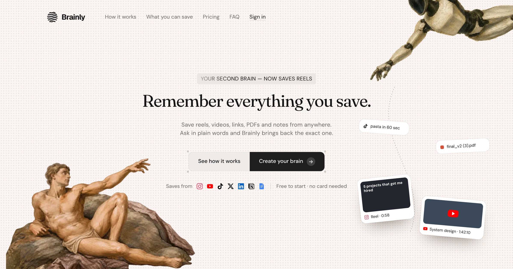
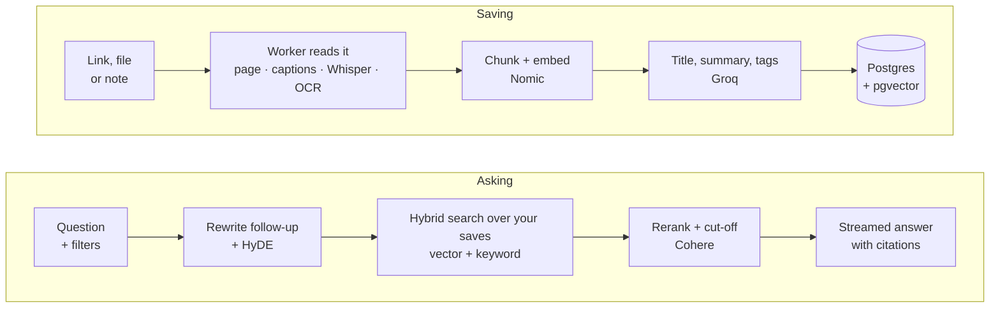

<div align="center">

<picture>
  <source media="(prefers-color-scheme: dark)" srcset=".github/assets/brainly-logo-dark.svg">
  
</picture>

### Your second brain for everything you save.

Reels, YouTube videos, tweets, articles, PDFs and notes in one place.<br>
Ask in plain words and get answers that cite exactly what you saved.

[**Open Brainly**](https://brainlyai.me) · [Features](#features) · [How it works](#how-it-works) · [Run it locally](#run-it-locally) · [API](#api)


[](LICENSE.md)

<br>



</div>

---

## Why Brainly

Useful things are scattered across apps: a reel with project ideas, a YouTube tutorial, a thread on X, a PDF from a course, a note to self. Bookmarks pile up and nothing is findable when you need it.

Brainly is one place to save all of it. It reads each save for you (captions, transcripts, page text, scanned PDFs), writes a title, summary and tags, and lets you ask questions like *"that reel about project ideas"* or *"what did my PDFs say about transformers?"*. Every answer shows the saves it came from.

## Features

**Save anything, from anywhere**
- **Videos and reels:** YouTube videos and Shorts, Instagram Reels and TikToks, with captions or an audio transcript (Whisper), author, thumbnail and duration
- **The web:** articles and pages (clean text via Readability and Open Graph, LinkedIn posts too), and X posts shown with the author, photos and video
- **Your own stuff:** notes in Markdown, PDFs (scanned ones are OCR'd), images (OCR or an AI description) and voice notes recorded in the browser
- **Imports** from Notion and Google Docs (`.md`, `.txt`, `.html`, `.docx` or a Notion `.zip`)
- **Browser extension** for Chrome, Edge, Brave, Opera, Arc, Vivaldi, Firefox and Safari: save the page, a link or selected text
- **Installable app** with **Share → Brainly** on Android

**Find it again**
- **Ask** in plain words. Answers come only from your saves, stream in live and cite each source `[1]`; sources open the original or play reels and videos inline
- **Filters as you type:** `/instagram`, `/youtube`, `/link`, `/note`, `/pdf`, `/week`, `/month`… and `@` to ask within a collection
- **Live matches** while you type, so you see Brainly has the right saves before asking
- **Find mode** (`/find`) lists matches instantly with no AI answer
- **Chats** with follow-ups ("show me more like that") and history
- **Hybrid retrieval:** pgvector and Postgres full-text, HyDE, reciprocal rank fusion and Cohere rerank with relevance cut-offs, with a keyword fallback if embeddings are down

**Organise**
- A Pinterest-style **library** with type tabs, search, sort, starred and archive
- **Tags** (yours plus AI auto-tags) and an AI summary for every memory
- **Collections** you can share publicly with a link
- **Rediscover:** spaced-repetition review and throwbacks to old saves
- **Duplicate** detection, and a page to find and merge them
- A **knowledge graph** of how your saves connect

**Built properly**
- Postgres-backed job queue (`FOR UPDATE SKIP LOCKED`) with retries, backoff and visible failures
- **Your account, your data:** email verification, forgot-password reset links, a one-click ZIP export of everything you saved, and account deletion
- **Connected devices:** every extension sign-in is listed in Settings and can be signed out on its own, plus "sign out everywhere"
- httpOnly-cookie sessions, rate limiting, SSRF protection on every fetched URL, upload type and size limits, private file serving
- Local disk or S3 / Cloudflare R2 storage
- Free and premium plan limits (memories, daily AI answers, upload size)
- JSON request logs, Docker Compose, GitHub Actions CI, unit and integration tests

## How it works



**Saving:** `POST /api/content` validates the request and stores the memory as `pending`. The worker extracts its text, splits and embeds it, adds a title, summary and tags, and marks it `ready`.

**Asking:** the question is rewritten if it's a follow-up, expanded with a hypothetical answer (HyDE), searched by meaning and by keyword with your filters, de-duplicated, reranked and cut off below a relevance threshold. Then the answer streams back with numbered citations.

## Tech stack

| Layer | Technology |
| --- | --- |
| Language | TypeScript, end to end |
| Frontend | Next.js 16, React 19, Tailwind CSS 4, Motion |
| Backend | Node.js 22, Express 5, Zod |
| Database | PostgreSQL + pgvector (Neon or self-hosted), Prisma 7 |
| AI | Nomic embeddings, Groq (Qwen, gpt-oss, Whisper), Cohere rerank, Gemini vision |
| Auth | JWT in httpOnly cookies, Google and GitHub OAuth |
| Infra | Vercel + Render, Docker Compose, GitHub Actions, S3 / R2 (optional) |

<details>
<summary><b>Project structure</b></summary>

```
Brainly-AI/
├── backend/                 # Express API + background worker
│   ├── src/
│   │   ├── index.ts         # app setup, middleware, error handling
│   │   ├── routes/          # auth, content, chat/search, collections, insights
│   │   ├── ingest/          # web, youtube, reel, tiktok, transcribe, imports, enrich…
│   │   ├── lib/             # auth cookies, SSRF-safe fetch, storage, plans, filters, LLM client
│   │   ├── worker.ts        # Postgres-backed job queue
│   │   ├── processMemory.ts # extract → chunk → embed → summarise/tag
│   │   ├── Retrieval.ts     # hybrid search, rerank, cut-offs
│   │   └── rag.ts           # retrieval + prompt building for answers
│   └── test/                # vitest unit + integration tests
├── frontend/                # Next.js app: Ask, Library, Collections, Graph, public /c/[slug]
├── db/                      # Prisma schema, migrations and client
├── extension/               # Browser extension (Manifest V3)
└── docker-compose.yml       # Postgres + pgvector, API, web
```

</details>

## Run it locally

### With Docker (everything included)

```bash
cp backend/.env.example backend/.env   # add your AI API keys
docker compose up --build
```

Open http://localhost:3000. Migrations run automatically on start.

### Without Docker

You need Node.js 22+, pnpm, and PostgreSQL with the `pgvector` extension (or a Neon database). `yt-dlp` on your PATH is optional, for reel, TikTok and YouTube audio transcripts.

```bash
pnpm install
cp backend/.env.example backend/.env           # fill it in
cp frontend/.env.example frontend/.env.local

pnpm --filter db build
pnpm --filter db exec prisma migrate deploy

pnpm dev    # web on :3000, API on :3001
```

`backend/.env.example` lists every setting: storage, OAuth, email, worker and retrieval tuning.

Password reset and email verification need an email provider: set `RESEND_API_KEY` ([Resend](https://resend.com), free tier) or `SMTP_URL` (any SMTP server, e.g. Gmail with an app password), plus `EMAIL_FROM`. Without one, emails are printed to the API's log in development and not sent in production.

### Tests

```bash
pnpm test                                    # unit tests
TEST_DATABASE_URL=postgresql://… pnpm test   # + integration tests against a migrated pgvector database
pnpm lint
```

<details>
<summary><b>Deploying (Vercel + Render)</b></summary>

The web app proxies every API request through its own domain at `/backend`, so the sign-in cookie is first-party and browsers don't block it.

- **Frontend (Vercel):** set `BACKEND_URL` to your API's address, e.g. `https://brainly-api.onrender.com`.
- **Backend:** set `CLIENT_URL` to the web app's address, `COOKIE_SAMESITE=lax` and `TRUST_PROXY=2`.
- **Backend build command (Render):** `pnpm install --frozen-lockfile && pnpm build`. `pnpm build` applies pending migrations when `DATABASE_URL` is set, so schema changes reach production with each deploy.
- **Google sign-in:** set `GOOGLE_CALLBACK_URL` to `https://<your-web-app>/backend/auth/google/callback` and add the same URL to the authorised redirect URIs in Google Cloud Console.
- **Custom domain:** put it first in the backend's `CLIENT_URL` (e.g. `https://brainlyai.me,https://brainly-ai-frontend.vercel.app`) and set `NEXT_PUBLIC_SITE_URL=https://brainlyai.me` on Vercel. Visitors on the production `*.vercel.app` address are then redirected to the domain, and Google / GitHub sign-in returns to the address it started from.

</details>

<details>
<summary><b>Browser extension</b></summary>

One extension works in every desktop browser. Build the packages first:

```bash
pnpm build:extension
```

This writes `extension/dist/chromium/` and `extension/dist/firefox/`, plus a `.zip` of each ready to upload to the stores.

**Install it yourself (no store needed)**

| Browser | How |
| --- | --- |
| Chrome, Brave, Arc, Vivaldi | `chrome://extensions` → turn on **Developer mode** → **Load unpacked** → pick `extension/` (or `extension/dist/chromium/`) |
| Edge | `edge://extensions` → **Developer mode** → **Load unpacked** → same folder |
| Opera | `opera://extensions` → **Developer mode** → **Load unpacked** → same folder |
| Firefox | `about:debugging#/runtime/this-firefox` → **Load Temporary Add-on** → pick `extension/dist/firefox/manifest.json` (removed when Firefox restarts) |
| Safari (Mac) | `xcrun safari-web-extension-converter extension/dist/chromium` (needs Xcode), run the app it creates, then enable it in Safari → Settings → Extensions |

Then a **Connect Brainly** tab opens (or click **Connect Brainly** in the extension). Sign in if asked and the extension connects by itself. In Firefox and Safari, allow access to the Brainly site when asked. After pulling a new version, click **Reload** (↻) on the extension, or the browser keeps running the old one.

**Publish it**

| Store | Covers | Upload | Cost |
| --- | --- | --- | --- |
| [Chrome Web Store](https://chrome.google.com/webstore/devconsole) | Chrome, Brave, Arc, Vivaldi, Opera | `brainly-chromium-<version>.zip` | one-time $5 |
| [Microsoft Edge Add-ons](https://partner.microsoft.com/dashboard/microsoftedge) | Edge | `brainly-chromium-<version>.zip` | free |
| [Firefox Add-ons](https://addons.mozilla.org/developers/) | Firefox desktop and Android | `brainly-firefox-<version>.zip` | free |
| [Opera Add-ons](https://addons.opera.com/developer/) | Opera | `brainly-chromium-<version>.zip` | free |
| App Store (Safari) | Safari on Mac, iPhone and iPad | the Xcode project from `safari-web-extension-converter` | $99/year |

Bump `version` in `extension/manifest.json` before each upload. The extension talks to `https://brainlyai.me` by default (installs from before 1.3.0 keep using the vercel.app address, which still works). For your own deployment, change the address in `extension/api.js` and `extension/manifest.json` (`host_permissions`, `content_scripts.matches`), or use the extension's **Settings → Advanced** with a token from `/extension`.

</details>

<details>
<summary><b>Mobile share sheet and premium plans</b></summary>

**Share sheet:** open Brainly in Chrome on Android and choose **Install app**. Brainly then appears in the system **Share** menu; sharing a reel, video, link or text saves it straight away (`/share`), and Brainly names it and adds a summary and tags.

**Premium:** plan limits live in `backend/src/lib/plans.ts`. Set `User.isPremium = true` to upgrade a user; no payment provider is wired up yet.

</details>

## API

All `/api/*` routes need the session cookie (web app) or `Authorization: Bearer <token>` (extension and API clients).

<details>
<summary><b>All endpoints</b></summary>

| Method | Endpoint | Description |
| --- | --- | --- |
| POST | `/signup`, `/signin`, `/logout` | Email and password sign-in (sets or clears the session cookie) |
| GET | `/auth/google`, `/auth/github` | OAuth sign-in (when configured) |
| POST | `/auth/forgot-password`, `/auth/reset-password` | Email a reset link; set a new password from it (signs out every other session) |
| POST | `/auth/verify-email`, `/api/account/verify-email` | Confirm the email from its link; send the link again |
| GET | `/api/me` | Current user, plan and usage |
| POST | `/api/extension-token` | Long-lived token for the browser extension (each one is a connected device) |
| GET / DELETE | `/api/devices[/:id]` | Connected extensions; sign one out (`current` = the caller) |
| POST | `/api/account/sign-out-everywhere` | Sign out every other browser and extension |
| GET | `/api/account/export` | ZIP of everything saved: JSON, notes as Markdown, uploaded files |
| DELETE | `/api/account` | Delete the account and all its data (`confirm`: the email, plus `password` if set) |
| POST | `/api/content` | Save a link, note or file (`type` is detected for YouTube, Instagram, TikTok and X links) |
| POST | `/api/import` | Import Notion, Google Docs or Markdown files as notes |
| GET | `/api/content` | List memories: `view`, `types`, `q`, `tag`, `collectionId`, `sort` (`newest` / `oldest`), `cursor`, `limit` |
| GET | `/api/content/counts` | Totals per type, starred, archived and added this week |
| GET | `/api/content/status?ids=` | Poll processing status |
| PATCH | `/api/content/:id` | Edit title, note, context, tags, starred, archived |
| DELETE | `/api/content/:id` | Delete a memory and its file |
| POST | `/api/content/:id/retry` | Retry a failed memory |
| POST | `/api/content/:id/review` | Spaced-repetition review result |
| GET / POST | `/api/content/duplicates`, `/api/content/merge` | Find and merge duplicates |
| GET | `/api/files/:id` | Download an uploaded file |
| GET | `/api/tags` | Tags with counts |
| POST | `/api/chat/stream` | Ask, streamed as Server-Sent Events (`meta` → `token`… → `done`) |
| POST | `/api/chat` | Ask (single JSON response) |
| GET | `/api/search?q=` | Plain search, no AI answer |
| GET / DELETE | `/api/conversations[/:id]` | Chat history |
| CRUD | `/api/collections[/:id]`, `/api/collections/:id/memories`, `/api/collections/:id/share` | Collections and sharing |
| GET | `/api/public/collections/:slug` | A publicly shared collection |
| GET | `/api/graph`, `/api/rediscover` | Knowledge graph, review digest |

</details>

## Why I built it

I kept losing things: bookmarks piled up, good threads disappeared, and research was impossible to find again. Brainly is the tool I wanted to use every day.

It also pushed me to make real engineering decisions rather than follow tutorials: relational modelling with Prisma, a pnpm monorepo with shared TypeScript types, a Postgres job queue, hybrid retrieval and cookie-based auth across a proxied frontend and API.

## Author

**Bodarni Furqan**, full-stack engineer · TypeScript, Node.js, Next.js, PostgreSQL, Prisma<br>
[GitHub](https://github.com/Furqan-7) · [LinkedIn](https://linkedin.com/in/furqan-132378327) · [X](https://x.com/B_Furqan07)

## License

Brainly is released under the [Functional Source License 1.1, Apache 2.0 Future License](LICENSE.md) (FSL-1.1-ALv2).

- **You may** read, run, modify and self-host Brainly for yourself or your team, and use it for learning, research and non-commercial projects.
- **You may not** offer Brainly, or a product built from it, as a commercial service that competes with Brainly.
- **Two years after each release**, that version becomes available under the Apache License 2.0, with no restrictions.

For other uses, [get in touch](https://x.com/B_Furqan07).
